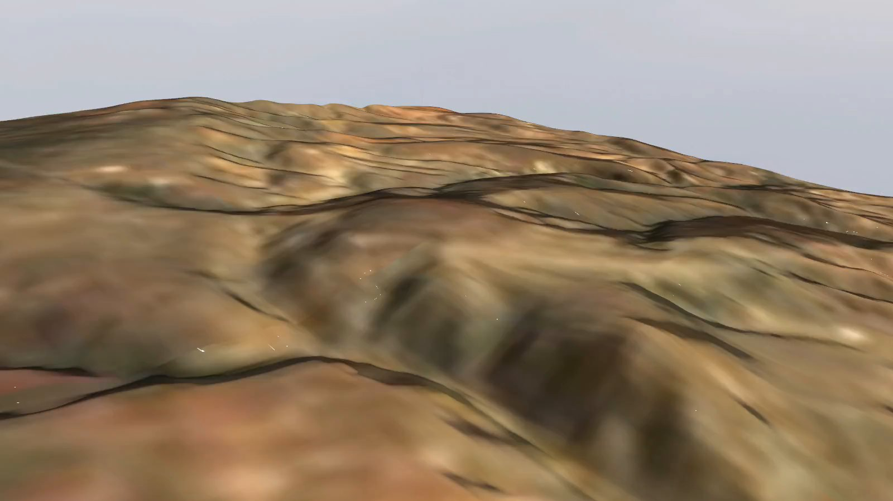
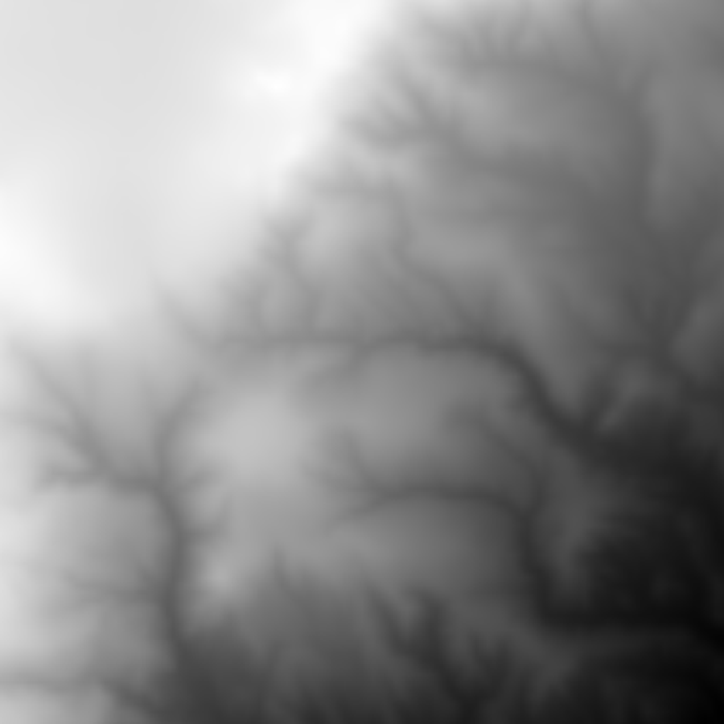
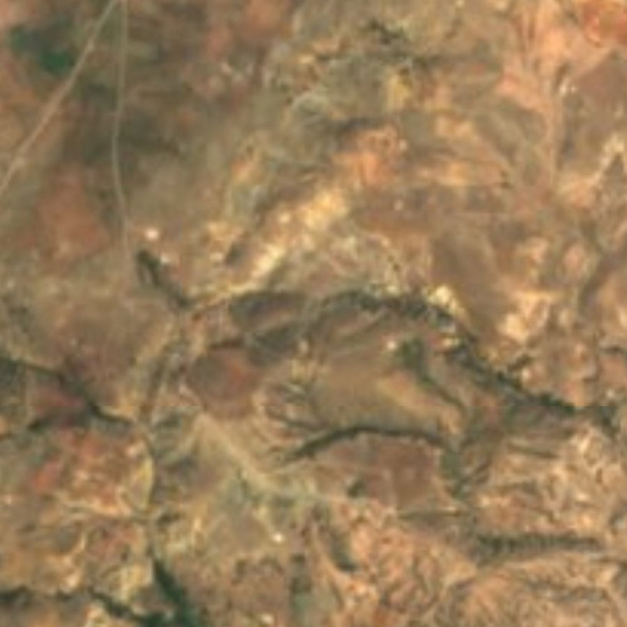
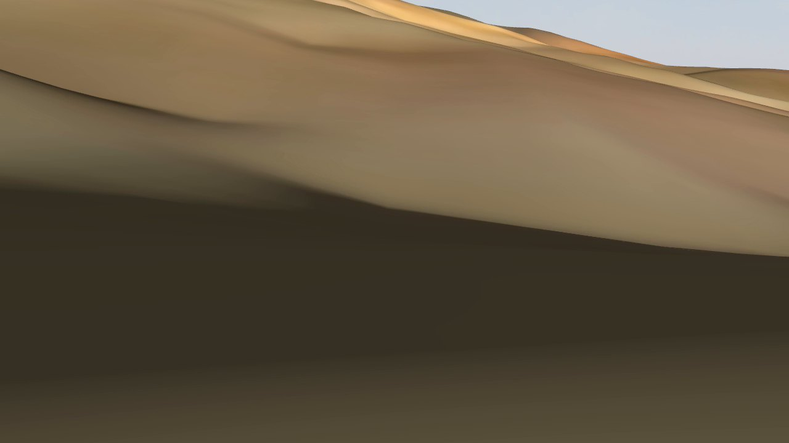
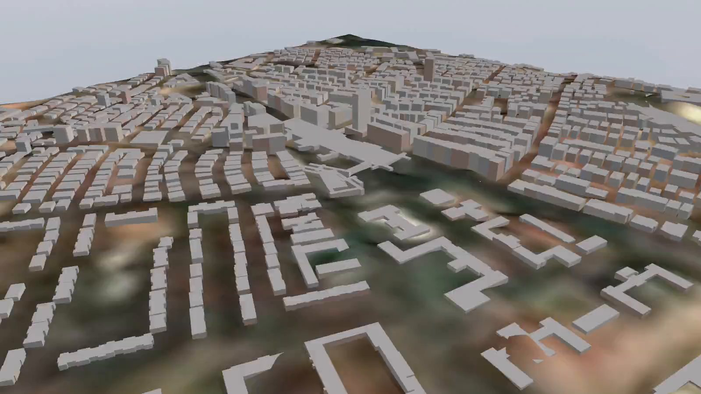
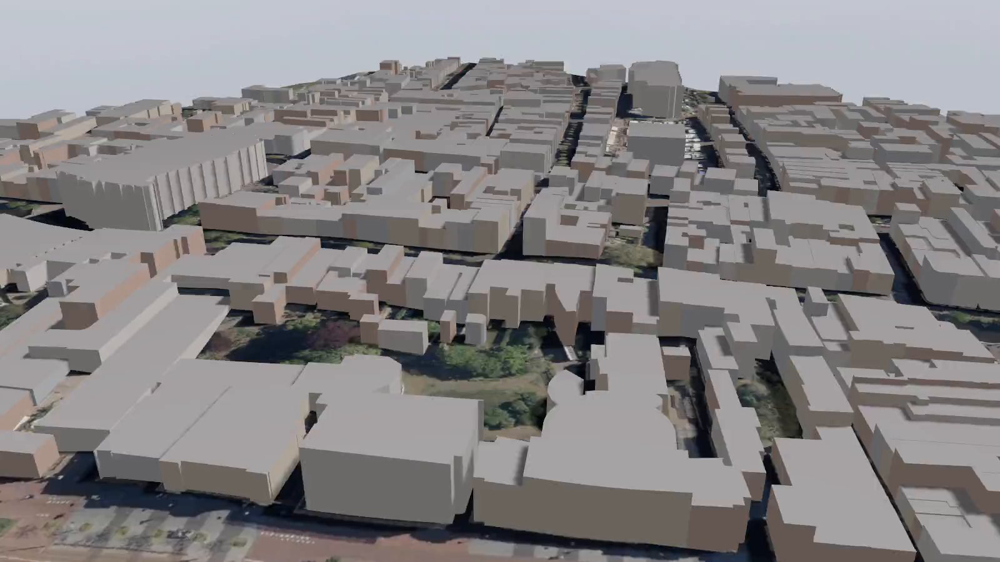
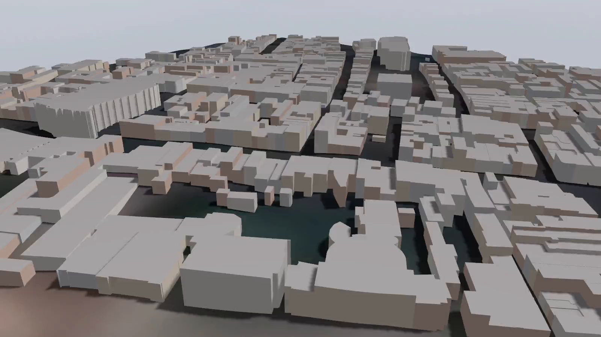

# hangar-earth

**Gazebo worlds from real places.** Give it a point on the map and a size;
it builds a Gazebo world with the real terrain and satellite imagery, located
at the right coordinates, ready for ArduPilot SITL.



<sub>3 km × 3 km of hills east of Ankara (39.88, 33.23), 945–1291 m above sea level, rendered by Gazebo Harmonic.</sub>

[Türkçe](#türkçe)

```bash
hangar-earth create --lat 39.88 --lon 33.23 --size 3000 --name ankara_hills
```

It takes about 15 seconds. The result is a folder with an SDF world, the
heightmap, the satellite texture, a normal map, and credits for the data.

| Elevation (Copernicus DEM, 30 m) | Imagery (Sentinel-2 cloudless, 10 m) | A plane's nose camera on the ground |
|---|---|---|
|  |  |  |

## Buildings

Buildings come from OpenStreetMap and are on by default (`--no-buildings`
leaves them out). Heights come from `height` or `building:levels` tags, or
from a typical height for the building type. Every building becomes walls
and a flat roof in **one mesh**, so a district of thousands of buildings
stays fast. The mesh collides: a box dropped on the 76 m tower in Kızılay
lands on its roof.



## Sharper than 30 m / 10 m

The free global data stops at 30 m terrain and 10 m imagery. Sharper
satellite maps (Google, Bing, Esri) do not allow this use. You can still go
sharper with data you are allowed to use:

- `--dem FILE.tif`: your own elevation, such as a drone survey DSM, LiDAR, or
  a national DEM, in any coordinate system. It replaces the global terrain
  where it covers the area. The heightmap resolution follows its pixel size,
  up to 4097 samples per edge.
- `--imagery FILE.tif`: your own orthophoto (RGB GeoTIFF, any coordinate
  system), for example from OpenDroneMap. Large files are read only at the
  resolution needed. Textures can be up to 8192 px.
- `--imagery-url TEMPLATE`: XYZ tiles from a service whose terms allow it,
  with `--imagery-zoom` and `--imagery-credit`. You are responsible for the
  source's license.

Some countries publish open aerial imagery: the Netherlands (PDOK, CC BY 4.0),
France (IGN), Spain (PNOA), Switzerland (swisstopo) and the US (NAIP). Delft
with PDOK's open 8 cm imagery, downsampled to 15 cm per pixel:

```bash
hangar-earth create --lat 52.0116 --lon 4.3571 --size 600 --name delft --texture 4096 \
  --imagery-url 'https://service.pdok.nl/hwh/luchtfotorgb/wmts/v1_0/Actueel_orthoHR/EPSG:3857/{z}/{x}/{y}.jpeg' \
  --imagery-zoom 19 --imagery-credit "Luchtfoto © Beeldmateriaal Nederland / PDOK, CC BY 4.0"
```

| Open aerial imagery, 15 cm per pixel | Sentinel-2, 10 m |
|---|---|
|  |  |

A vertical datum note: Copernicus heights are above the geoid (EGM2008). If
your DEM uses ellipsoid heights, it can sit tens of metres off at its edges.
Convert it first.

## What you get

- **Terrain** from the [Copernicus DEM GLO-30](https://spacedata.copernicus.eu/collections/copernicus-digital-elevation-model).
  Only the part of each tile the area needs is read from its public
  cloud-optimised GeoTIFF; no account is needed. Areas over open sea are flat
  at 0 m.
- **Ground texture** from [EOX Sentinel-2 cloudless 2016](https://s2maps.eu)
  (CC BY 4.0). Tiles are downloaded in parallel and cached in
  `~/.cache/hangar-earth`.
- **Lighting**: a normal map is computed from the terrain, so the sun lights
  the slopes.
- **Location**: `<spherical_coordinates>` holds the real latitude and
  longitude, and the world's origin sits at the lowest point of the area, so
  heights above the origin plus `elevation` give heights above sea level.
- **ArduPilot-ready**: the world loads the physics, IMU, NavSat and sensors
  systems that ArduPilot's Gazebo plugin needs. Physics sees the terrain, so
  vehicles stand on the hills.
- **For tools**: `hangar-earth.json` holds the metadata, and `heights.u16` has
  the ground heights as raw little-endian decimetres. Hangar uses it to put
  each vehicle on the ground.

## Use it

### With Hangar (easiest)

```bash
hangar world create --lat 39.88 --lon 33.23 --size 3000 --name ankara_hills
```

Hangar installs hangar-earth into its own folder the first time (after
showing the license). The world then shows up in `hangar worlds` and the
Scenario tab. Vehicles start on the ground, so a pose's `z` is the height
above the terrain, and their GPS positions are the real ones.

### On its own

```bash
uv tool install git+https://github.com/Enginar140/hangar-earth
hangar-earth create --lat 39.88 --lon 33.23 --size 3000 --name ankara_hills
GZ_SIM_RESOURCE_PATH=$PWD/ankara_hills gz sim ankara_hills/ankara_hills.sdf
```

Options: `--size` sets the edge length in metres (100 m to 20 km, default
3000), `--texture` the texture size (1024, 2048 or 4096 px), `--resolution`
the heightmap samples per edge (2^k + 1, chosen automatically, about 6 m per
sample). `hangar-earth info FOLDER` shows a world's metadata.

## Limits

- **Detail**: the terrain is 30 m and the imagery 10 m. Hills, valleys and
  ridges are right, but trees, walls and roads are not modelled as shapes.
  The texture looks soft close to the ground.
- **Size**: a few km² runs well. Large areas are slow to render.
- **Buildings are boxes with flat roofs**: no roof shapes or textures. OSM
  coverage varies: city centres are usually complete, and villages may miss
  buildings. The Copernicus DEM is a surface model, so in dense cities the
  ground is a little raised where buildings stand. Buildings sit on the
  lowest point of their footprint.
- **Imagery from 2016**: the newer cloudless mosaics are licensed for
  non-commercial use only, so the CC BY 2016 one is used.

## Data and credits

hangar-earth's code is MIT. The data it downloads stays under its own terms,
and each world gets an `ATTRIBUTION.txt`. Keep it when you share the world:

- Copernicus DEM GLO-30: © DLR e.V. 2010-2014 and © Airbus Defence and Space GmbH 2014-2018, provided under COPERNICUS by the European Union and ESA; all rights reserved.
- Sentinel-2 cloudless - https://s2maps.eu by EOX IT Services GmbH (Contains modified Copernicus Sentinel data 2016), licensed CC BY 4.0.
- Buildings © OpenStreetMap contributors, available under the Open Database License (ODbL).
- Your own files and tile sources: their own terms. `--imagery-credit` goes into `ATTRIBUTION.txt`.

## Development

```bash
uv sync
uv run pytest        # offline: synthetic DEM tiles and imagery
uv run hangar-earth create --lat 39.88 --lon 33.23 --name test
```

Releases: bump `__version__` in `src/hangar_earth/__init__.py`, add a
CHANGELOG section, and push a `vX.Y.Z` tag.

---

## Türkçe

**Gerçek yerlerden Gazebo dünyaları.** Haritada bir nokta ve bir boyut
verirsin; gerçek arazisi, uydu görüntüsü ve doğru koordinatlarıyla, ArduPilot
SITL'e hazır bir Gazebo dünyası üretir. Yaklaşık 15 saniye sürer.

```bash
hangar world create --lat 39.88 --lon 33.23 --size 3000 --name ankara_hills   # Hangar ile
hangar-earth create --lat 39.88 --lon 33.23 --size 3000 --name ankara_hills   # tek başına
```

- **Arazi**: Copernicus DEM GLO-30 (30 m). Hesap gerekmez; sadece gereken parça indirilir.
- **Zemin dokusu**: EOX Sentinel-2 cloudless 2016 (10 m, CC BY 4.0), önbelleğe alınır.
- **Konum**: dünya gerçek enlem/boylamında. Hangar araçları yere koyar
  (`pose`'un `z`'si yerden yüksekliktir); araçların GPS konumları gerçek
  konumlarıdır.
- **ArduPilot'a hazır**: gerekli Gazebo sistemleri yüklü. Fizik araziyi zemin
  olarak görür.
- **Binalar**: OpenStreetMap'ten, varsayılan olarak açık (`--no-buildings`
  ile kapatılır). Yükseklik `height` ya da kat sayısı etiketinden, yoksa bina
  tipinden gelir. Tüm binalar tek bir modelde birleşir, bu yüzden hızlıdır.
  Fizikte katıdır, yani çatıya inilebilir.
- **Daha yüksek çözünürlük**: açık ve dünya çapında veri 30 m arazi ve 10 m
  görüntüde biter. Daha keskini için kendi verini kullanabilirsin:
  `--dem dosya.tif` (drone DSM'i, LiDAR, ulusal DEM; herhangi bir koordinat
  sistemi), `--imagery dosya.tif` (örn. OpenDroneMap ortofotosu) ya da
  kullanım hakkın olan bir karo servisi: `--imagery-url`. Yukarıda Delft
  örneği var: 15 cm açık hava fotoğrafı ile 10 m Sentinel-2 karşılaştırması.
- **Sınırlar**: binalar düz çatılı kutular. OSM kapsaması yerden yere değişir.
- **Lisans**: kod MIT. İndirilen verinin atıf bilgileri her dünyanın
  `ATTRIBUTION.txt` dosyasında; dünyayı paylaşırken bu dosyayı da paylaş.
